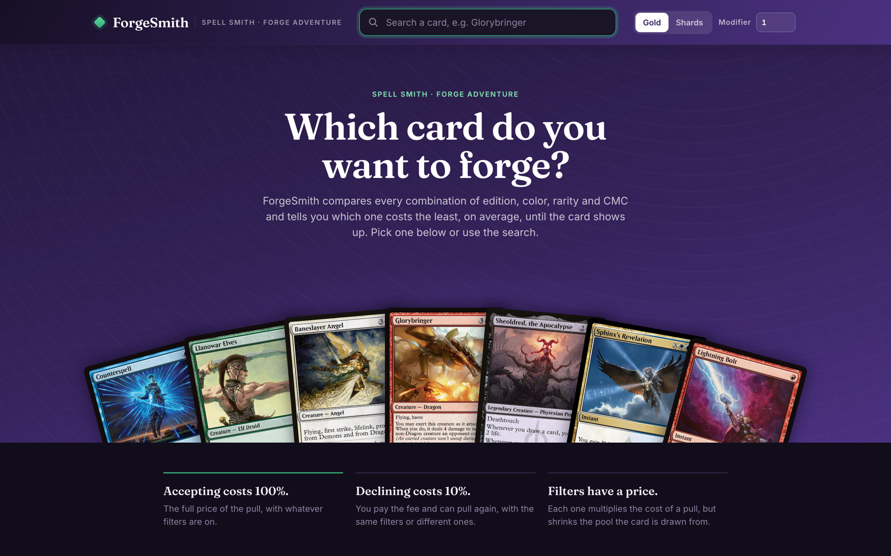
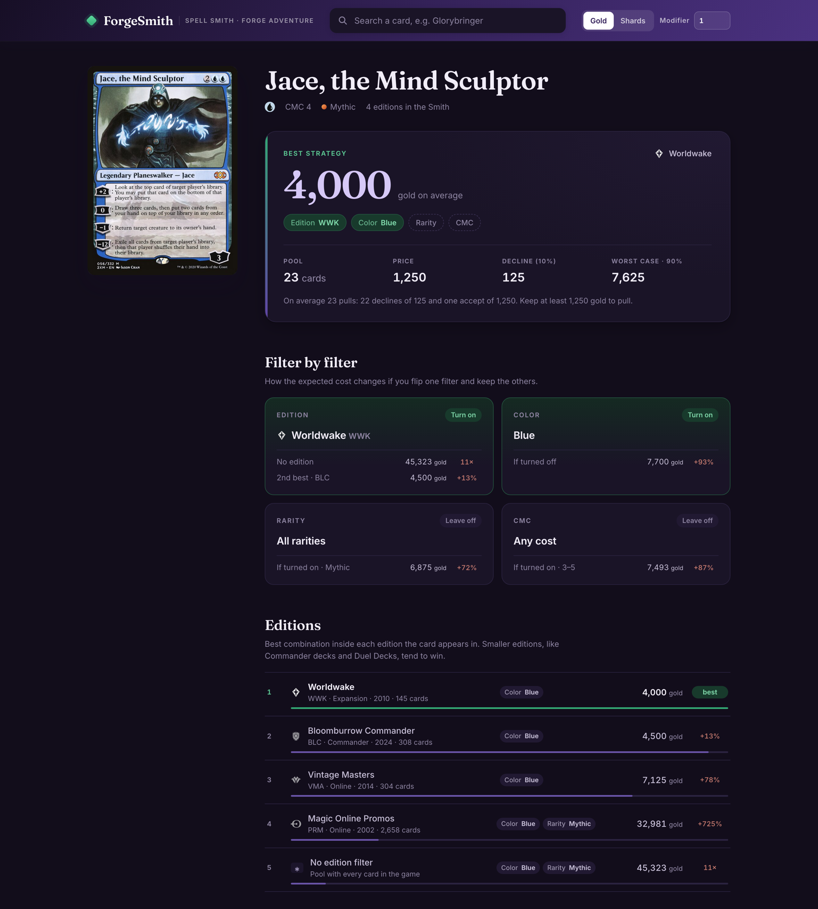

# ForgeSmith

Find the cheapest way to get a specific card out of the **Spell Smith** in [Forge](https://github.com/Card-Forge/forge) Adventure mode.

The Spell Smith lets you filter by edition, color, rarity and mana value, then draws a random card from what's left. Every filter makes each pull more expensive but shrinks the pool, and declining a card still costs 10% of the price. ForgeSmith works out every filter combination for the card you want and ranks them by **expected cost**: what you'll spend on average before the card shows up.



## What you get for each card

- **Best strategy:** which filters to turn on, the pool size, the price per pull, the decline fee, and the expected and worst-case (90th percentile) cost.
- **Filter by filter:** what happens to the cost if you flip just one filter.
- **Editions:** the best combination inside every edition the card appears in. Small sets such as Commander decks and Duel Decks usually win.
- **All combinations:** every option, from cheapest to most expensive.



Prices can be shown in gold or shards, and you can enter your price modifier from equipped items and blessings.

## How the cost is calculated

ForgeSmith reproduces the rules in Forge's `SpellSmithScene`:

| Filter | Price multiplier |
|---|---|
| Edition | ×4 |
| Color | 1 color ×2.5 · 2 colors ×5 · 3+ ×6 |
| Rarity | Common ×1.5 · Uncommon ×2.5 · Rare ×4 · Mythic ×5.5 |
| Mana value | ×2.5 |

The base price is 125 gold. Every pull ends in a decision: **accepting costs 100%** of the price and **declining costs 10%**. The card is drawn uniformly from the filtered pool, so:

> **expected cost = price + decline × (pool − 1)**

The color filter matches colors exactly. Picking only Red never gives you a red-green card.

## Running it

### Docker (recommended)

```bash
docker compose up -d --build
```

The site runs at http://localhost:8080. Compose starts two services:

- **web**: nginx serving the release build. The app code is obfuscated; third-party code stays in `vendor-*.js`.
- **updater**: keeps the card data in sync with Forge. It refreshes on start and then once a day. Until its first refresh finishes, nginx serves the data snapshot baked into the image.

| Variable | Default | What it does |
|---|---|---|
| `FORGESMITH_PORT` | `8080` | Published port of the site |
| `UPDATE_TIME_UTC` | `06:00` | Time of the daily refresh (UTC) |
| `FORGE_BRANCH` | `master` | Forge branch to follow |

```bash
docker compose exec updater python updater.py --once   # refresh now
docker compose logs -f updater                         # refresh history
```

### Development

```bash
npm install
npm run dev
```

`npm run build` produces a readable build. `npm run build:release` adds the obfuscation step used by the Docker image.

## Card data

`public/data/smith.json` is generated from a Forge checkout. The generator rebuilds the same card pool, editions and rarities that the Spell Smith uses in game. Only a few folders of the Forge repository are needed:

```bash
git clone --depth 1 --filter=blob:none --sparse https://github.com/Card-Forge/forge.git forge
git -C forge sparse-checkout set forge-gui/res/cardsfolder forge-gui/res/editions forge-gui/res/adventure/common
npm run data -- forge
```

## Languages

The interface follows the browser language and falls back to English when that language isn't available. You can also pick a language in the footer, and the choice is remembered. English and Brazilian Portuguese are available.

To add a language, copy `src/i18n/pt-BR.ts`, translate it, and register it in `LOCALES` in `src/i18n/index.tsx`. Every dictionary is typed against the English one, so a missing key fails the build.

## Credits

- Card pool, editions and Spell Smith rules: [Forge](https://github.com/Card-Forge/forge).
- Card images and mana/set symbols: [Scryfall](https://scryfall.com).

ForgeSmith is unofficial fan content. It is not approved or endorsed by Wizards of the Coast. Magic: The Gathering and its card images are property of Wizards of the Coast LLC.
